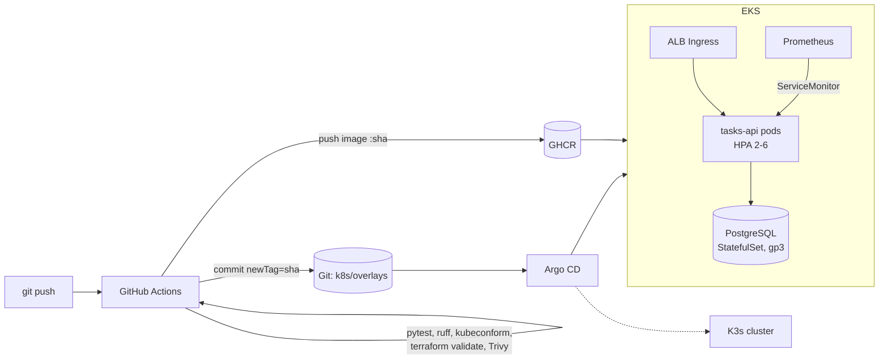

# K8s GitOps Platform: EKS + K3s

A production-style delivery platform that runs the same containerized service on two Kubernetes distributions:

- **Amazon EKS** (cloud), provisioned with Terraform: VPC, managed node group, IRSA, EBS CSI, AWS Load Balancer Controller.
- **K3s** (local/edge), either on a laptop with k3d or on a single EC2 instance, at a fraction of EKS's cost.

Deployments are **GitOps-driven**: CI tests, scans and publishes the image, then commits the new image tag to Git. **Argo CD** notices the commit and rolls it out. Prometheus, Grafana and Alertmanager provide metrics and alerting in both environments.

## Architecture



| Layer | EKS | K3s |
|---|---|---|
| Provisioning | Terraform (`infra/terraform/eks`) | k3d config, or Terraform EC2 (`infra/terraform/k3s-ec2`) |
| Ingress | AWS Load Balancer Controller (ALB) | Traefik (bundled with K3s) |
| Storage | EBS CSI driver, encrypted `gp3` StorageClass | `local-path` (bundled) |
| Secrets | Random password created at bootstrap, never in Git | Generated dev-only secret |
| Scaling | HPA 2-6 replicas, PDB, topology spread | HPA 1-3 replicas |
| Delivery | Argo CD auto-sync + self-heal | `kubectl apply -k`, or Argo CD |

## What's in the repo

```
app/                      FastAPI service: CRUD, /healthz, /readyz, Prometheus /metrics, pytest suite
k8s/base/                 Deployment, Service, HPA, PDB, NetworkPolicy, PostgreSQL StatefulSet
k8s/overlays/k3s|eks/     Per-environment ingress, storage, replicas, image
infra/terraform/bootstrap S3 + DynamoDB remote state backend (one-time)
infra/terraform/eks       VPC, EKS, managed node group, IRSA roles
infra/terraform/k3s-ec2   Single-node K3s on EC2 (IMDSv2, SG locked to your IP)
gitops/argocd/            Argo CD Applications
monitoring/               kube-prometheus-stack values, ServiceMonitor, alert rules
scripts/                  k3s-local-up, eks-bootstrap, eks-destroy
.github/workflows/ci.yml  Test, validate, scan, publish, promote
```

## Design decisions

- **Kustomize base + overlays.** One set of manifests, with only the real environment differences (ingress class, storage, replica floor, image source) in overlays. Easy to diff and review.
- **Restricted Pod Security Standard** is enforced on the namespace: non-root, read-only root filesystem, all capabilities dropped, seccomp `RuntimeDefault`.
- **Separate probes.** `/healthz` is liveness (the process is alive). `/readyz` is readiness and checks the database, so a pod that can't reach PostgreSQL drops out of the load balancer instead of being restarted in a loop.
- **Zero-downtime rollouts.** `maxUnavailable: 0`, a PodDisruptionBudget, and topology spread across nodes.
- **Bounded metric cardinality.** Request metrics are labelled with the route template (`/api/tasks/{task_id}`), not the raw path.
- **NetworkPolicy.** Only API pods can reach PostgreSQL.
- **IRSA instead of node IAM.** The ALB controller and EBS CSI driver each get their own least-privilege role.
- **Cost controls.** Spot nodes, a single NAT gateway, and a K3s option with no control-plane fee.
- **In-cluster PostgreSQL** keeps the demo self-contained. In production this would move to RDS.

## Run it locally on K3s (free)

Requirements: Docker Desktop, [k3d](https://k3d.io), kubectl, helm.

```bash
./scripts/k3s-local-up.sh
curl -X POST http://tasks.localhost:8080/api/tasks -H 'content-type: application/json' -d '{"title":"hello k3s"}'
curl http://tasks.localhost:8080/api/tasks
kubectl -n monitoring port-forward svc/monitoring-grafana 3000:80   # admin / change-me-local-only
make k3s-down
```

## Deploy to EKS

> **Cost warning:** EKS charges about USD 0.10/hour for the control plane, plus nodes, NAT gateway and ALB. Expect roughly **USD 5-6 per day**. Run `make eks-destroy` as soon as you're done.

```bash
# 1. One-time remote state
cd infra/terraform/bootstrap && terraform init && terraform apply -var state_bucket_name=<unique-name>

# 2. Cluster
cd ../eks && cp backend.hcl.example backend.hcl   # fill in the bucket name
terraform init -backend-config=backend.hcl && terraform apply

# 3. Add-ons, monitoring, Argo CD, app
cd ../../.. && ./scripts/eks-bootstrap.sh
```

The image is pulled from GHCR, so make the `tasks-api` package **public** in GitHub, or add an `imagePullSecret`.

Tear down with `./scripts/eks-destroy.sh`. It deletes the Ingress first so the ALB is removed before Terraform destroys the VPC.

## K3s on EC2 (optional)

```bash
cd infra/terraform/k3s-ec2
terraform init -backend-config=../eks/backend.hcl -backend-config="key=tasks-platform/k3s-ec2/terraform.tfstate"
terraform apply -var admin_cidr=$(curl -s https://checkip.amazonaws.com)/32 -var ssh_public_key="$(cat ~/.ssh/id_ed25519.pub)"
```

## CI pipeline

| Job | What it checks |
|---|---|
| `test` | ruff lint + pytest (CRUD, probes, validation, metric labels) |
| `manifests` | Renders both overlays and validates them with kubeconform |
| `terraform` | `fmt`, `init`, `validate` for each stack |
| `image` | Builds the image, Trivy scan (fails on fixable HIGH/CRITICAL), pushes `:sha` to GHCR |
| `promote` | Commits the new tag to `k8s/overlays/eks`; Argo CD deploys it |

## Roadmap

- External Secrets Operator + AWS Secrets Manager instead of bootstrap-created secrets
- Amazon RDS for PostgreSQL on EKS
- Karpenter for node autoscaling
- Argo Rollouts canary releases gated on the error-rate alert
